# Pullscope

A fast desktop app for reviewing GitHub pull requests. It is built with Tauri v2 (a Rust backend and a Preact + TypeScript frontend), runs on macOS, Windows and Linux, and talks straight to the GitHub API. There is no server in between: your token stays on your machine.

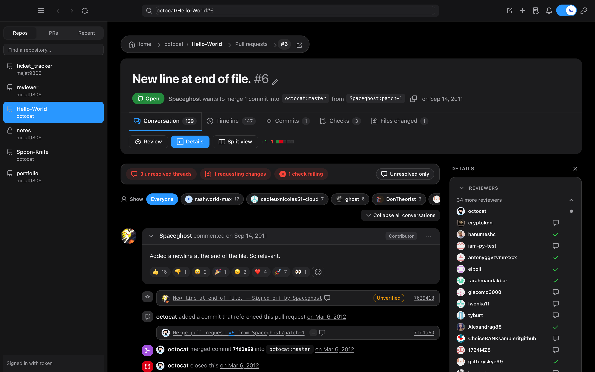

> The screenshots show the public PR [octocat/Hello-World#6](https://github.com/octocat/Hello-World/pull/6) with some sample repositories, checks and reviewers filled in so every screen has something to show.

## Pullscope vs. reviewing on github.com

Pullscope does not replace GitHub. It reads and writes the same pull requests through the GitHub API, so everything you do there shows up on github.com and the other way round. What changes is how you work through a pile of PRs.

| | github.com | Pullscope |
|---|---|---|
| Where it runs | A browser tab among many | A dedicated desktop app (macOS, Windows, Linux) |
| Several PRs at once | One page per PR, you juggle browser tabs | Built-in tabs that survive a restart and show a dot when a background PR has new activity |
| Commits and diff next to the conversation | Separate pages; you jump between tabs | **Split view** shows the conversation and the commits or diff side by side |
| What needs your attention | You read the page to find unresolved threads, failing checks and requested changes | **Attention chips** summarise them at the top and jump you to each one |
| Your review queue | Notifications and the PR list, spread over several pages | An **Inbox** of PRs waiting on you, your approved PRs ready to merge, and your own open PRs |
| Staying current | You reload the page | The open PR refreshes itself when something changes; a notification and a menu-bar count appear for new commits, comments, reviews and branch pushes |
| Slow or no network | Page fails to load | Shows the last saved copy and a quiet offline indicator; GitHub replies are cached by ETag, so unchanged data costs no API rate limit |
| Opening a PR | Navigate through repo pages | Paste `owner/repo#123` or a URL in the address bar, with autocomplete |
| Starting a PR | One long form | Searchable repository and branch pickers (your branches first, grouped by prefix, with last-commit age), PR templates filled in for you, reviewers and labels beside the description |
| Writing a comment | The box is at the very bottom of a long page | A docked comment bar that is always in reach (`C` to open) |
| Narrowing a long conversation | Hide resolved threads, filter files | Filter by person and by date range, flip the sort order, show unresolved threads only |
| Long diffs | Can be slow to render | Syntax-highlighted, unified or side by side, loaded progressively |
| Memory use | A full browser page per PR | One app that keeps a few PRs open and caches them on disk, with no always-on blur layers and lazy-loaded avatars |

### What github.com still does better

Pullscope is only about pull requests. It has no issues, projects, discussions, code search or file browsing, no repository settings, and no Actions log viewer (failed checks open on GitHub). Re-running checks works for GitHub Actions only, and notifications are polled about once a minute because GitHub has no push channel for third-party apps. For anything outside the review loop, use github.com.

## What it does

**Read a pull request**
- Conversation, timeline, commits, checks and files tabs, with attention chips (unresolved threads, requested changes, failing checks) and a filter by author.
- Syntax-highlighted diffs, unified or side by side, with collapsible files. Long diffs load progressively so big PRs stay fast.
- **Split view**: commits and their diff beside the conversation, resizable, with a flip button and per-pane collapse.
- Collapse or expand every conversation, review and thread in one click.
- **Zoom** the whole interface with `Ctrl/⌘` + mouse wheel or `Ctrl/⌘` + `+` / `-` / `0`; the level is remembered.
- **Appearance** (profile menu → *Appearance…*): pick the font (System, Classic, Serif, Rounded, Monospace), the size of reading text and of code in diffs, the window zoom, and comfortable or compact lists. A preview shows the result and *Reset* restores the defaults. The toolbar and dialogs adapt to narrow windows.

  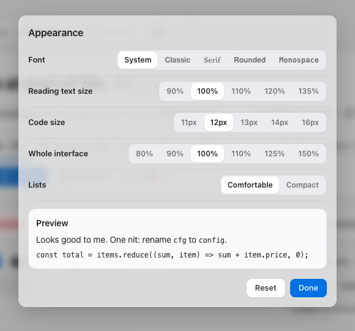
- Filter the conversation by person, by **date range** (last hour, 24 hours, 7 or 30 days, or custom dates) and flip it **newest first / oldest first**. A scroll button (or `Home` / `End`) appears on every long page: a down arrow at the top, an up arrow further down.
- **Tabs**: keep several PRs open at once (`⌘T`, `⌘W`, `⌘⇧T`, `⌘1–9`; `⌘`-click or middle-click a PR to open it in a new tab). Tabs survive a restart and show a dot when a background tab has new activity; the + menu lists recent PRs. Drag tabs to reorder them.

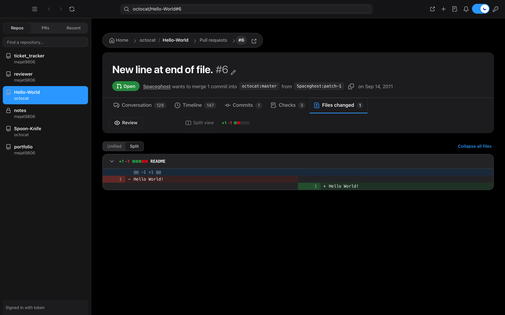

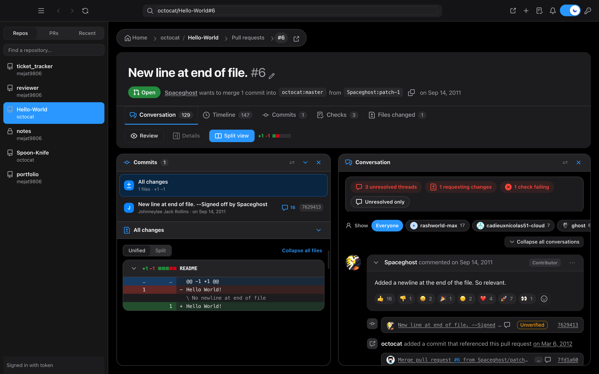

**Review**
- Line comments with a rich editor (toolbar with a link button and `⌘K`, `` `code` `` as you type, GitHub-style markdown shortcuts, `@` mentions, `:` emoji; pasted Markdown, including fenced code, lists and headings, is parsed like on GitHub), saved as a draft review and submitted together.
- Suggested changes, plus an **Apply suggestion** button that commits the change to the PR branch.
- A **docked comment bar** stays at the bottom of the conversation, collapsed by default. It opens when you click it, press `C`, or scroll to the end of the thread, and folds away when you scroll back up (never while it holds a draft).
- Approve and Request changes are hidden on your own pull request, where GitHub only allows Comment.
- The Reviewers list shows people with a verdict first (changes requested, approved, commented), then people who still have to answer, then bots; five show before the fold. A grey refresh button asks someone to review again, and a yellow clock marks someone you already asked.

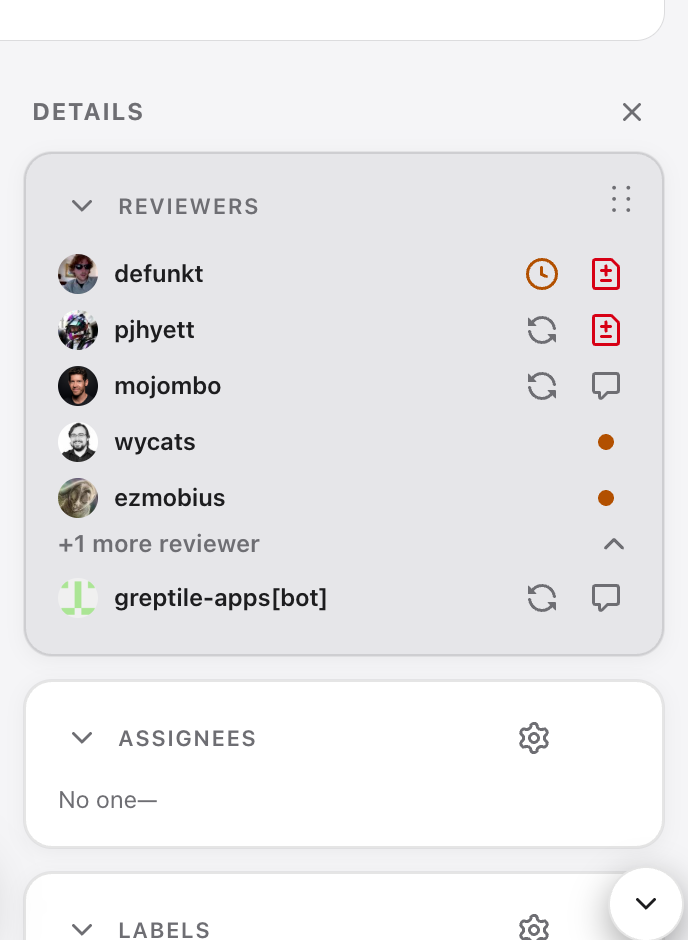
- Resolve and unresolve threads, re-request a review, react to comments. A comment menu copies a link or the Markdown, quotes, references a comment in a new issue, and edits, hides or deletes your own.
- Tick task-list checkboxes directly in a description or comment; the change is saved to GitHub.
- **Write / Preview** tabs on every text box. The preview is rendered by GitHub, so it matches what gets posted.

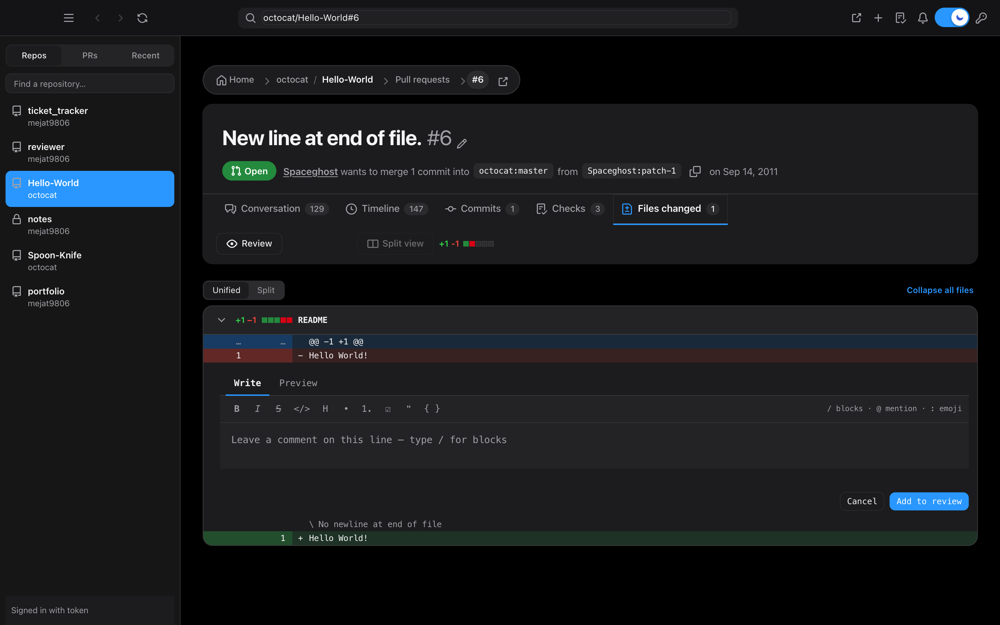

**Manage the pull request**
- Create a PR: pick the repo, base and head from searchable pickers (your branches first, the rest grouped by prefix with last-commit age), title, rich description, draft option, reviewers, assignees, labels, milestone and linked issues (`Closes #N`).
- Edit the title and description, mark ready for review or convert back to draft, close and reopen.
- A GitHub-style merge box: review status, grouped checks with **Required** badges, **Re-run failed** (GitHub Actions), **Update branch**, merge method, **auto-merge**.

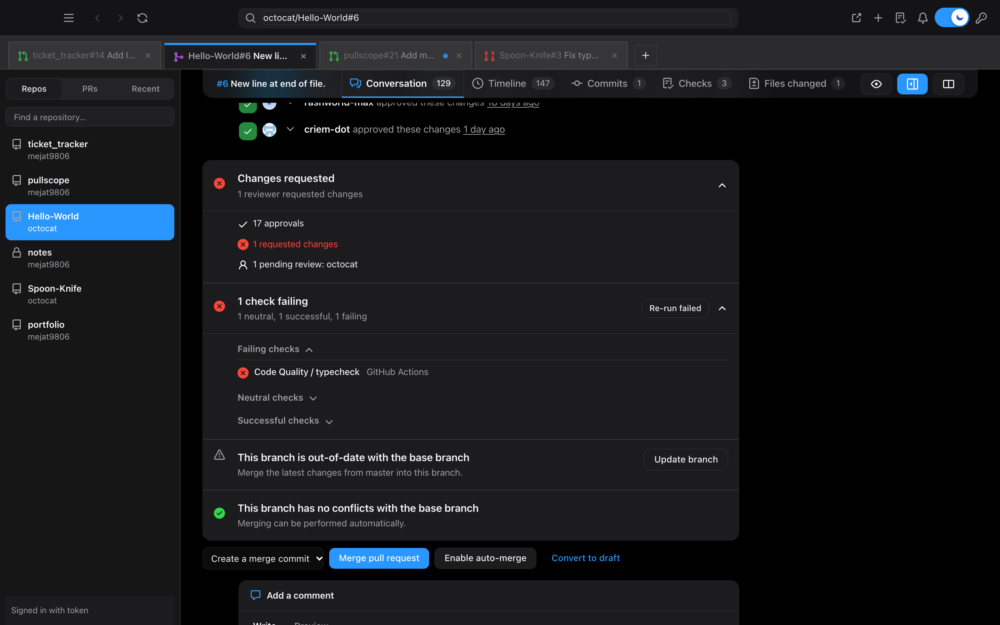

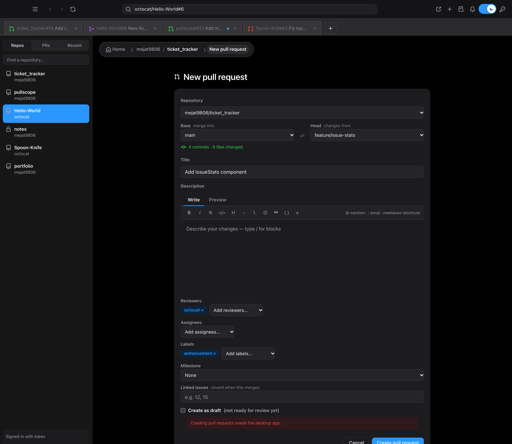

**Stay on top of things**
- **Choose repositories**: tick the repositories you care about (profile menu → *Choose repositories…*, or the Repos tab). The sidebar, address-bar suggestions, inbox and notification polling then fetch only those, which also saves API rate limit. Tick none or all to use every repository; pasting a PR link still opens any repository.
- **Rearrange**: drag the ⋮⋮ grip to reorder the Inbox sections, the sidebar's repository list and the blocks of a PR's side panel. The order is remembered.
- **Viewed files**: tick *Viewed* on a file in the Files tab to fold it away; the files bar shows progress (`5/12 viewed`) and marks or clears every file. A mark is dropped when the file changes.
- **Copy summary** (button beside the PR title) copies the title, status, size, reviewers and link; **Compact** lists in Appearance make rows denser.
- **Edit PR details**: the gear on a PR's Assignees, Labels and Milestone opens a picker and saves to GitHub (the token needs write access).
- **Home**: all your repositories and recently opened PRs as a full page. Breadcrumbs on every page.
- **Inbox**: PRs waiting on your review, your approved PRs ready to merge, your own open PRs, PRs where you were mentioned, PRs you took part in, and recently closed or merged PRs you were involved in. Sections collapse, every section sorts, a filter box narrows them, and you can drag a section by its grip (or use the arrows) to put what matters to you first. Hover a row to **pin** it to a *Pinned* section or **snooze** it (until tomorrow, next week or new activity); snoozed PRs wait in a *Snoozed* section. Save a filter and sort as a named **view**. Keyboard: `j`/`k` or arrows move, `Enter` opens, `p` pins, `s` snoozes, `e` folds a section, `/` filters.
- Notifications for new commits, comments, reviews and new branch pushes (with GitHub's "Compare & pull request" prompt), an unread count in the menu bar / tray, and a quiet offline indicator that falls back to the last saved copy.
- Keyboard shortcuts (press `?` in the app).

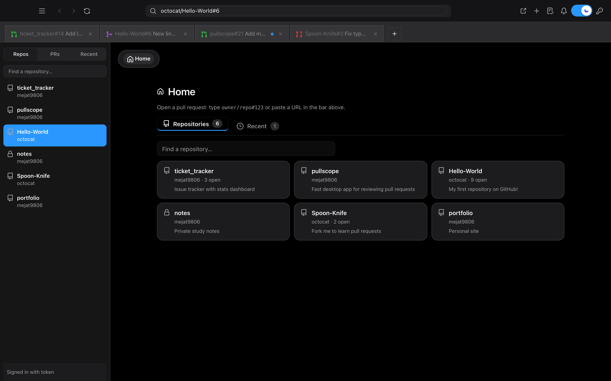

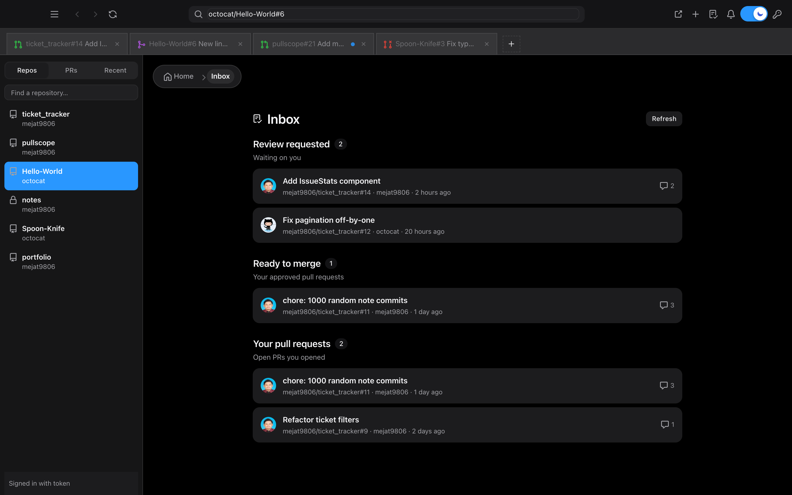

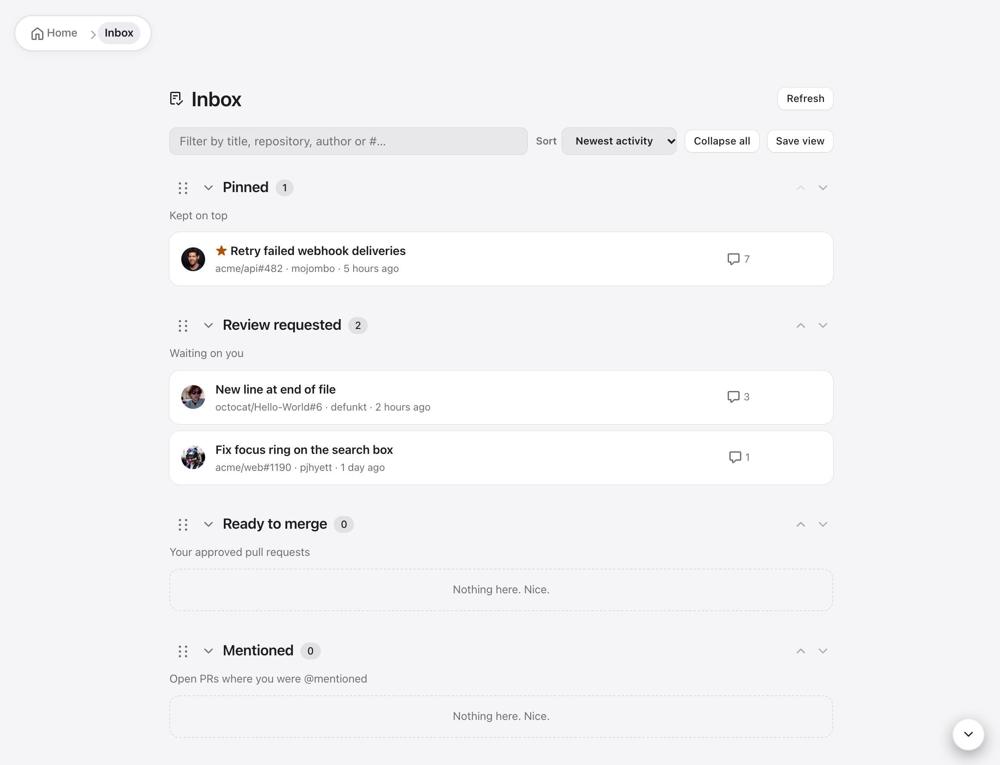

## Install

Download the installer for your platform from the [Releases page](https://github.com/mejat9806/pullscope/releases): `.dmg` (macOS, Apple silicon), `.exe` / `.msi` (Windows), `.deb` / `.rpm` / `.AppImage` (Linux).

The installers are not code-signed, so macOS (Gatekeeper) and Windows (SmartScreen) warn on first launch. Right-click and choose Open on macOS, or "More info" then "Run anyway" on Windows.

## Sign in

Pullscope requires a GitHub sign-in; without one it shows a sign-in screen instead of loading slowly at 60 requests an hour.

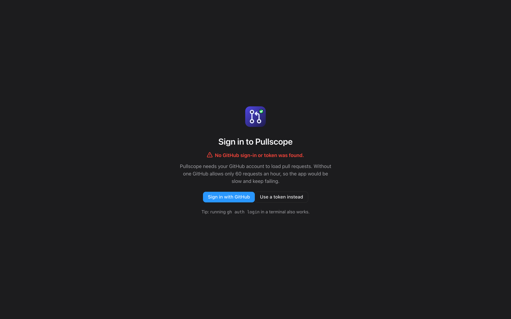

Choose **Sign in with GitHub** (device flow: enter the code shown on github.com), or **Use a token instead** and paste a **classic** personal access token with the `repo` scope (add `notifications` for the notifications poll).

The token is stored in the macOS Keychain, Windows Credential Manager or the Linux Secret Service (a running keyring such as GNOME Keyring is needed). `GITHUB_TOKEN` and `gh auth login` also work.

## Build from source

You need Rust. On macOS, with Homebrew's rustup:

```bash
export PATH=/opt/homebrew/opt/rustup/bin:$PATH
cd src-tauri
cargo run --bin github-pr-view                            # opens Home
cargo run --bin github-pr-view -- octocat/Hello-World#6   # opens a PR directly
```

Build and install a macOS app bundle into `/Applications`:

```bash
bash scripts/bundle.sh
```

The frontend is TypeScript + Preact under `web/`, bundled by esbuild into the committed `ui/app.js`. After editing it run `cd web && npm ci && npm run check && npm run build` (`npm run watch` while developing); `check` runs `tsc --noEmit` under `strict` and rejects explicit `any`.

**Code style** (ported from the Citadel monorepo and adapted): Prettier (`web/.prettierrc`: 80 columns, single quotes, trailing commas, `arrowParens: avoid`) and ESLint 9 flat config (`web/eslint.config.mjs`, rules in `web/eslint/base-rules.mjs`, the ones this codebase does not follow, with reasons, in `web/eslint/overrides.mjs`). Run `npm run format` and `npm run lint` (`lint:fix` for auto-fixes) in `web/`; CI runs `check`, `lint` and `format:check`. Names must say what they hold: single-letter names are rejected (`id-length`), and so are `cb` and `callback`, so write `event`, `bundle` or `appState`, not `e`, `b` or `S`. Disable a rule only with a comment saying why.

The rich editor and syntax highlighter are bundled with esbuild from `editor/`; the output is already committed in `ui/vendor/`. To rebuild them: `cd editor && npm install && npm run build`.

### Preview the UI in a browser

`cargo run --bin dump -- owner/repo#N ui/fixture.json` records the exact data the app renders. The UI can then run in any browser with no GitHub access:

```bash
python3 -m http.server 8765 --directory ui
# http://localhost:8765/index.html?fixture=fixture-hello-world-6.json&mode=dark&tab=files
```

Writing actions need the desktop app; in the browser preview they are disabled.

### Releases

Installed builds check for updates on launch and offer a one-click update (signed with `TAURI_SIGNING_PRIVATE_KEY`, set as a repository secret). The update button first shows the release notes, and they show once more after the restart. Unit tests run in CI (`cargo test --lib`).

Add the changes to the `## [Unreleased]` section of `CHANGELOG.md` as you go. To release, rename that section to the new version, bump the version in `src-tauri/tauri.conf.json`, `src-tauri/Cargo.toml` and `Cargo.lock`, and tag.

Pushing a `v*` tag runs `.github/workflows/release.yml`, which builds installers for macOS, Windows and Linux and attaches them to a **draft** GitHub Release whose notes are the matching `CHANGELOG.md` section. Publish the draft from the Releases page.

## Project layout

| Path | What is in it |
|---|---|
| `src-tauri/src/github.rs` | Fetches a PR, its timeline, files, review comments, checks and thread state from the REST and GraphQL APIs |
| `src-tauri/src/lib.rs` | Tauri commands: write actions, branches, create PR, notifications, inbox, markdown preview |
| `web/` | Frontend source (TypeScript, Preact, esbuild): `src/app/*` modules, `src/components/*` Preact components, `src/types.ts` domain types |
| `ui/app.js`, `ui/app.css` | Built frontend bundle (generated from `web/`, committed) and styles |
| `editor/` | Source of the rich text editor and highlighter bundles |
| `CHANGELOG.md` | Release notes per version; the tag's section becomes the GitHub release body |
| `scripts/` | `bundle.sh` builds and installs the macOS app |
| `swift/` | A separate native SwiftUI app (see below) |
| `docs/screenshots/` | Images used in this README |

## Known limits

- Re-running checks only works for GitHub Actions; checks from other services open on GitHub instead.
- Auto-merge only works if the repository has "Allow auto-merge" turned on.
- Windows and Linux notifications are plain banners; clicking one does not open the PR yet.
- GitHub allows 5,000 authenticated requests an hour. A 403 "rate limit exceeded" resets within the hour; choosing fewer repositories and the built-in ETag cache keep usage low.
- GitHub has no push channel for third-party apps, so notifications are polled about once a minute while the app is open.
- The pieces that talk to GitHub (resolve, apply suggestion, create PR, notifications, re-run) have been exercised by hand on a few repositories; automated tests cover parsing and the HTTP layer only.

## Native Swift apps (Mac + iPhone/iPad)

`swift/` holds a SwiftUI codebase that builds a macOS app and an iOS app with no web view. It needs Xcode and [XcodeGen](https://github.com/yonaskolb/XcodeGen).

```bash
cd swift && xcodegen generate
# Mac:    xcodebuild -project Reviewer.xcodeproj -scheme Reviewer-macOS -configuration Release build
# iPhone: xcodebuild -project Reviewer.xcodeproj -scheme Reviewer-iOS -destination 'platform=iOS Simulator,name=iPhone 18 Pro' build
```

On the Mac the token comes from `gh auth token`, then the Keychain; on iOS paste a token with the key button. It covers the repo and PR browser (filter, sort, group), conversation with attention chips, account filter and resolved-thread folding, timeline, commits, checks, files, and write actions (comment, reply, review, merge, close/reopen). Composer shortcuts: `/` block menu, `@` people, `:` emoji. It polls for notifications every minute and can pin a PR as a Live Activity in the Dynamic Island.

Not ported yet: the rich editor, split view and reactions. The Swift app does not have the newer features above (create PR, inbox, line comments, merge box).
