# Pullscope

A fast desktop app for reviewing GitHub pull requests. It is built with Tauri v2 (a Rust backend and a Preact + TypeScript frontend), runs on macOS, Windows and Linux, and talks straight to the GitHub API. There is no server in between: your token stays on your machine.

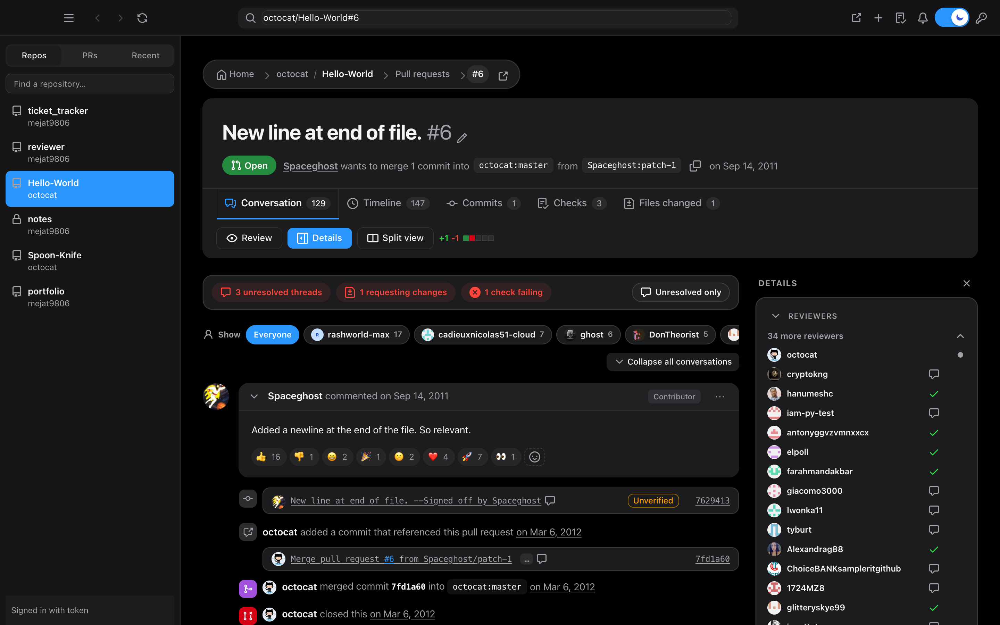

> The screenshots show the public PR [octocat/Hello-World#6](https://github.com/octocat/Hello-World/pull/6) with some sample repositories, checks and reviewers filled in so every screen has something to show.

## Pullscope vs. reviewing on github.com

Pullscope does not replace GitHub. It reads and writes the same pull requests through the GitHub API, so everything you do there shows up on github.com and the other way round. What changes is how you work through a pile of PRs.

| | github.com | Pullscope |
|---|---|---|
| Where it runs | A browser tab among many | A dedicated desktop app (macOS, Windows, Linux) |
| Several PRs at once | One page per PR, you juggle browser tabs | Built-in tabs that survive a restart and show a dot when a background PR has new activity |
| Commits and diff next to the conversation | Separate pages; you jump between tabs | **Split view** shows the conversation and the commits or diff side by side |
| What needs your attention | You read the page to find unresolved threads, failing checks and requested changes | **Attention chips** summarise them at the top and jump you to each one |
| Your review queue | Notifications and the PR list, spread over several pages | An **Inbox** of PRs waiting on you, your approved PRs ready to merge, and your own open PRs |
| Staying current | You reload the page | The open PR refreshes itself when something changes; a notification and a menu-bar count appear for new commits, comments, reviews and branch pushes |
| Slow or no network | Page fails to load | Shows the last saved copy and a quiet offline indicator; GitHub replies are cached by ETag, so unchanged data costs no API rate limit |
| Opening a PR | Navigate through repo pages | Paste `owner/repo#123` or a URL in the address bar, with autocomplete |
| Starting a PR | One long form | Searchable repository and branch pickers (your branches first, grouped by prefix, with last-commit age), PR templates filled in for you, reviewers and labels beside the description |
| Writing a comment | The box is at the very bottom of a long page | A docked comment bar that is always in reach (`C` to open) |
| Narrowing a long conversation | Hide resolved threads, filter files | Filter by person and by date range, flip the sort order, show unresolved threads only |
| Long diffs | Can be slow to render | Syntax-highlighted, unified or side by side, loaded progressively |
| Memory use | A full browser page per PR | One app that keeps a few PRs open and caches them on disk, with no always-on blur layers and lazy-loaded avatars |

### What github.com still does better

Pullscope is only about pull requests. It has no issues, projects, discussions, code search or file browsing, no repository settings, and no Actions log viewer (failed checks open on GitHub). Re-running checks works for GitHub Actions only, and notifications are polled about once a minute because GitHub has no push channel for third-party apps. For anything outside the review loop, use github.com.

## What it does

Each feature has its own section below, grouped by what you are doing. The [changelog](CHANGELOG.md) says which release added it.

### Reading a pull request

#### Conversation and attention chips
Conversation, timeline, commits, checks and files tabs. **Attention chips** at the top count unresolved threads, requested changes and failing checks and jump to each one. Collapse or expand every conversation, review and thread in one click.

#### Conversation filters
Filter the conversation by person and by **date range** (last hour, 24 hours, 7 or 30 days, or custom dates), and flip it **newest first / oldest first**.

#### Diffs
Syntax-highlighted diffs, unified or side by side (`d` switches), with collapsible files. Long diffs load progressively, and heavy files on big PRs start collapsed, so big PRs stay fast.

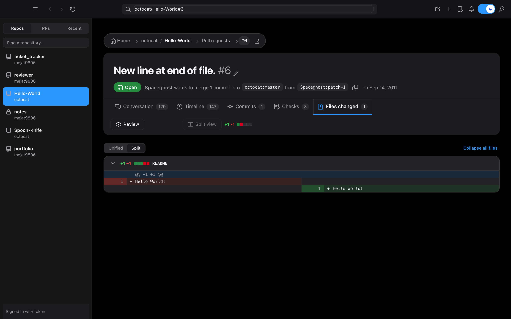

#### Files changed tab
Review threads appear inline next to their lines, where you can reply to and resolve them. Sort the files, and use the commit picker to see a single commit (with Prev / Next), a range of commits, or everything since your last review.

#### Viewed files
Tick *Viewed* on a file to fold it away. The files bar shows progress (`5/12 viewed`) and marks or clears every file. A mark is dropped when the file changes.

#### Split view
Commits and their diff beside the conversation, resizable, with per-pane collapse. `s` toggles it and `F` flips the sides.

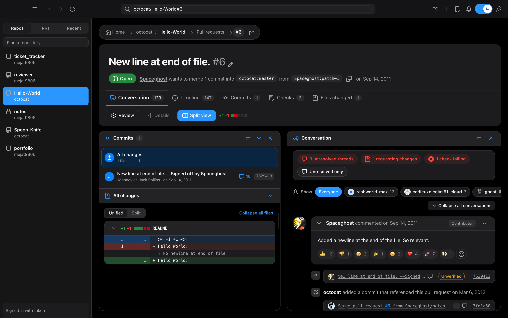

#### Find in page
`⌘F` / `Ctrl+F` searches everything visible in the current view, such as the conversation or a diff. All matches are highlighted with a match counter, `Enter` and `Shift+Enter` step through them, `Esc` closes the bar.

#### Scroll button
On every long page a down arrow at the top jumps to the bottom, and further down it becomes an up arrow back to the top. `End` and `Home` do the same.

#### Copy summary
A button beside the PR title copies the title, status, size, reviewers and link.

### Tabs

#### PR tabs
Keep several PRs open at once (`⌘T`, `⌘W`, `⌘⇧T` to reopen a closed tab, `⌘1–9`; `⌘`-click or middle-click a PR, or right-click it and choose *Open in new tab*). Opening a PR that already has a tab switches to it. Tabs keep their page, sub-tab and scroll position, survive a restart and show a dot when a background tab has new activity; the + menu lists recent PRs. Drag tabs to reorder them.

#### Closing several tabs
Right-click a tab for *Close tab*, *Close other tabs*, *Close tabs to the right* and *Close all tabs*.

#### Pinned tabs and tab groups
Right-click a tab to pin it: pinned tabs stay at the left, lose their close button and are kept by the bulk-close actions. Or add it to a new or existing group. Groups have a name and a colour, can be collapsed to a single chip, ungrouped, or closed together, and are restored after a restart.

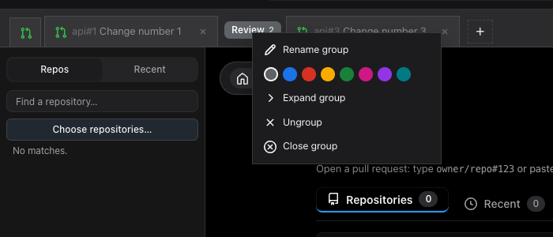

### Reviewing

#### Line comments and the rich editor
Line comments with a rich editor: a toolbar with a link button and `⌘K`, `` `code` `` as you type, GitHub-style markdown shortcuts, `@` mentions and `:` emoji. Pasted Markdown, including fenced code, lists and headings, is parsed like on GitHub. Comments are saved as a draft review and submitted together.

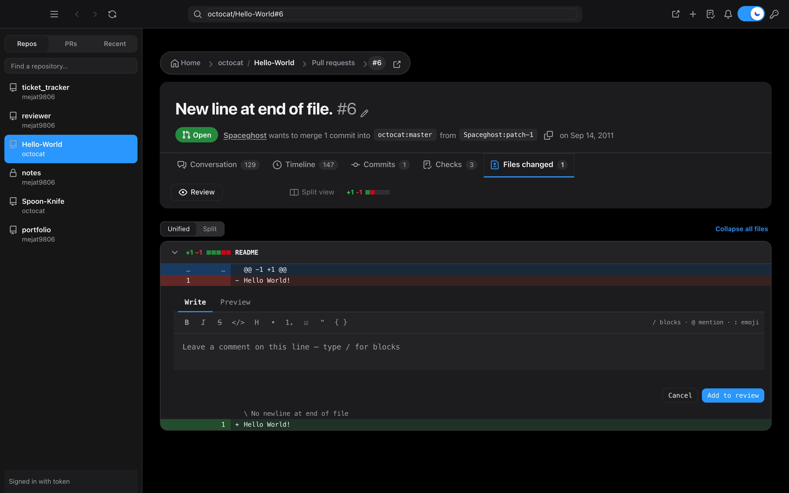

#### Images in any text box
Paste an image, drag it into the box, or use the 🖼 button in the toolbar. It works in the PR description, comments, replies and reviews. The app uploads the image to the repository the way github.com does and inserts ``; PNG, JPEG, GIF and WebP up to 10 MB are accepted. The editor shows the picture, or a small card when it cannot be loaded.

#### Write / Preview
Every text box has Write and Preview tabs. The preview is rendered by GitHub, so it matches what gets posted. Unsent text is kept as a draft and cleared once it is sent.

#### Docked comment bar
A comment bar stays at the bottom of the conversation, collapsed by default. It opens when you click it, press `C`, or scroll to the end of the thread, and folds away when you scroll back up (never while it holds a draft). `Esc` folds it.

#### Suggested changes
Suggest a change from a line comment, and use **Apply suggestion** to commit a suggestion to the PR branch.

#### Reviewers list
People with a verdict come first (changes requested, approved, commented), then people who still have to answer, then bots; five show before the fold. A grey refresh button asks someone to review again, and a yellow clock marks someone you already asked. Approve and Request changes are hidden on your own pull request, where GitHub only allows Comment.

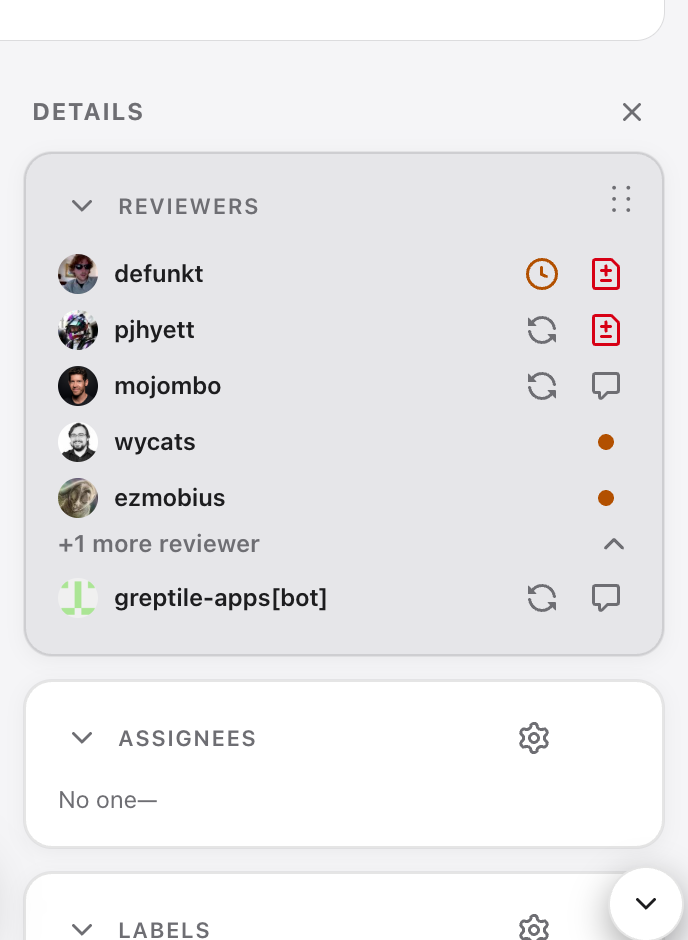

#### Threads, reactions and the comment menu
Resolve and unresolve threads and react to comments (click your reaction again to remove it). The comment menu copies a link or the Markdown, quotes, references a comment in a new issue, and edits, hides or deletes your own.

#### Task lists
Tick task-list checkboxes directly in a description or comment; the change is saved to GitHub.

### Managing the pull request

#### Creating a pull request
Pick the repository (search, recently pushed first, grouped by owner) and the base and head branches (your branches first, the rest grouped by prefix with last-commit age). Add a title, a rich description pre-filled from the repository's PR template (with a picker when there are several), a draft option, reviewers, assignees, labels, milestone and linked issues (`Closes #N`).

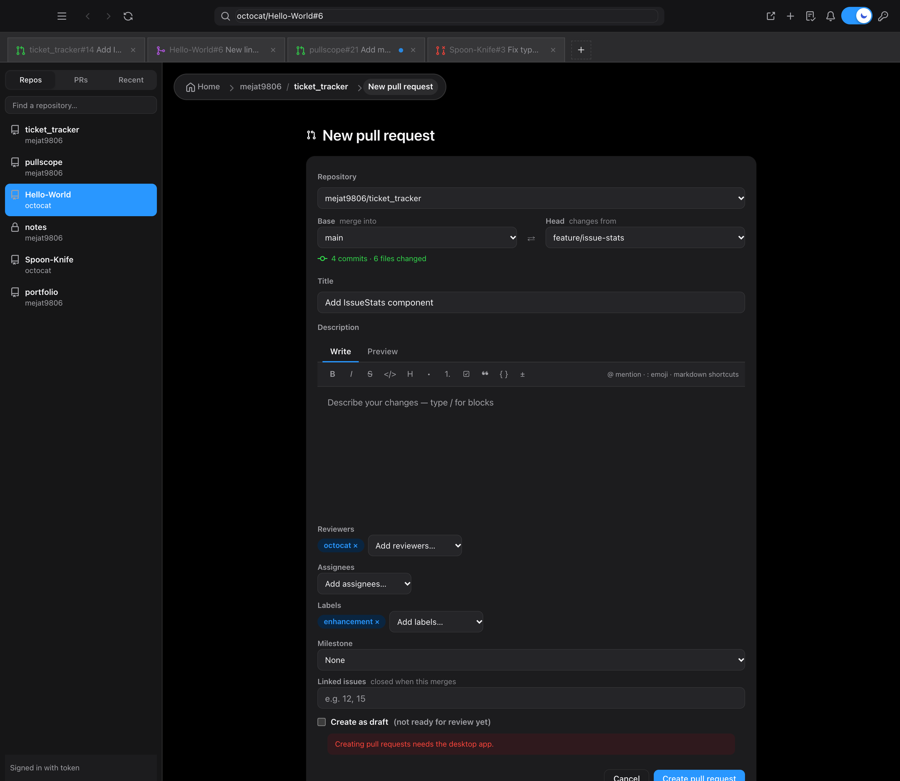

#### Editing a pull request
Edit the title and description, mark ready for review or convert back to draft, close and reopen.

#### Editing labels, assignees and milestone
The gear on a PR's Assignees, Labels and Milestone opens a picker and saves to GitHub (the token needs write access).

#### Merge box
A GitHub-style merge box: review status, grouped checks with **Required** badges, **Re-run failed** (GitHub Actions), **Update branch**, merge method and **auto-merge**.

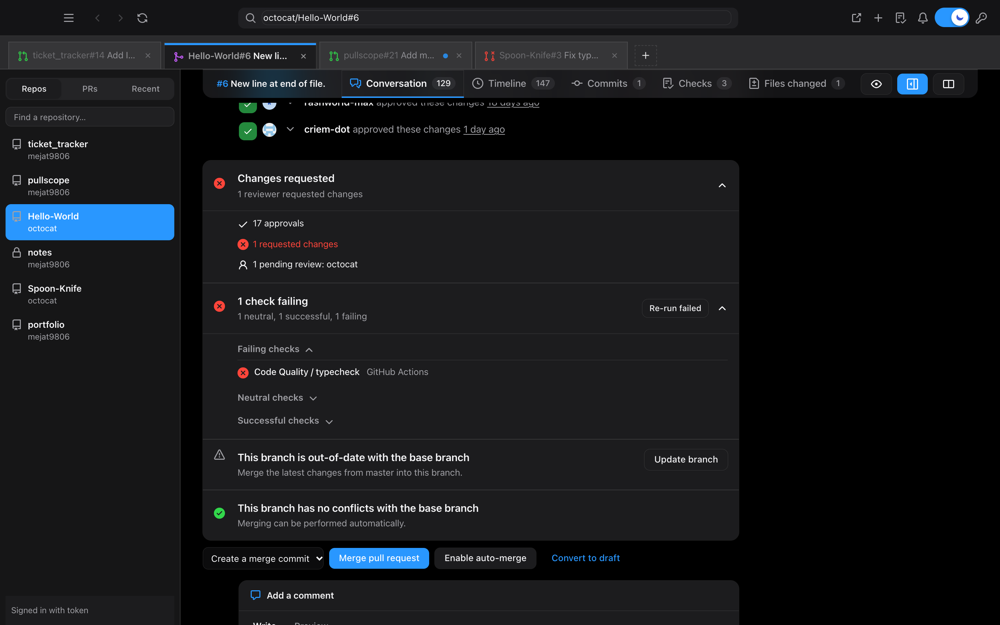

### Finding your way

#### Address bar
Paste `owner/repo#123` or a URL. Autocomplete suggests open tabs, recent PRs, repositories and a repository's PR numbers.

#### Home and breadcrumbs
Home shows all your repositories and recently opened PRs as a full page. Repositories can be filtered by public or private, sorted and grouped by owner; the Recent tab has a filter and a status toggle. Breadcrumbs on every page.

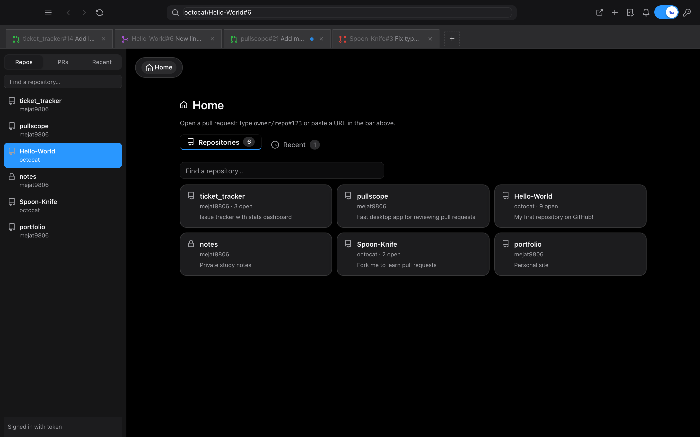

#### Repository pull request list
Opening a repository lists its open pull requests, with a search box and filters for author, label, status and sort.

#### Choose repositories
Tick the repositories you care about (profile menu → *Choose repositories…*, or the Repos tab). The sidebar, address-bar suggestions, inbox and notification polling then fetch only those, which also saves API rate limit. Tick none or all to use every repository; pasting a PR link still opens any repository.

#### Rearranging
Drag the ⋮⋮ grip to reorder the Inbox sections, the sidebar's repository list and the blocks of a PR's side panel. The order is remembered.

### Inbox

#### Inbox sections
PRs waiting on your review, your approved PRs ready to merge, your own open PRs, PRs where you were mentioned, PRs you took part in, and recently closed or merged PRs you were involved in. Sections collapse, every section sorts, a filter box narrows them, and you can drag a section by its grip (or use the arrows) to put what matters to you first.

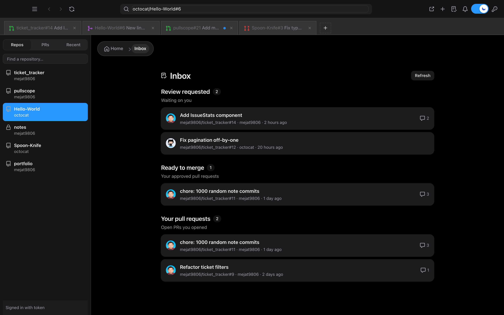

#### Pin and snooze
Hover a row to **pin** it to a *Pinned* section or **snooze** it (until tomorrow, next week or new activity). Snoozed PRs wait in a *Snoozed* section and come back by themselves.

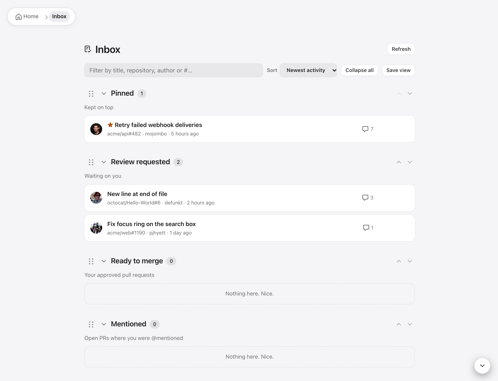

#### Saved views
Save the Inbox filter and sort under a name and pick it again later.

#### Inbox keyboard control
`j`/`k` or the arrow keys move, `Enter` opens, `p` pins, `s` snoozes, `e` folds a section, `/` jumps to the filter.

### Staying current

#### Notifications
Notifications for new commits, comments, reviews and new branch pushes (with GitHub's "Compare & pull request" prompt), and an unread count in the menu bar / tray. Every open tab and the PRs you wrote or were asked to review are watched without opening them.

Profile menu → *Notifications…* has a switch for each kind (commits, comments, reviews, branch pushes). A switched-off kind shows no desktop notification, no bell entry and no unread count. All kinds are on by default and the choice is remembered. Those switches are the default for every repository. Pick a repository in the same dialog to set each kind to *Default*, *On* or *Off* for just that repository.

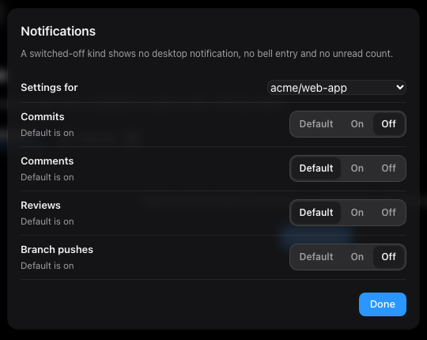

The bell dropdown shows each notification with an icon and a type label (Commits, Comments, Reviews, Branches, Status), and chips at the top filter the list by type. A notification stays highlighted and counted as unread until you click it (or mark it read on the full page).

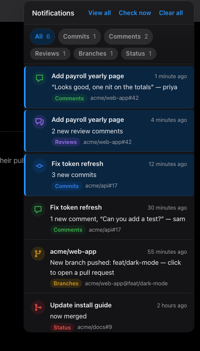

#### Live refresh and offline mode
The open PR refreshes itself when something changes. Without a network, a quiet offline indicator appears and the last saved copy is shown. GitHub replies are cached by ETag, so unchanged data costs no API rate limit.

#### In-app updates
The app checks for updates on launch and every hour. The *Update to vX* button opens *What's new in vX* with the release notes, and you choose *Update and restart* or *Later*. After the restart the notes show once more.

### Look and feel

#### Appearance
Profile menu → *Appearance…*: pick the font (System, Classic, Serif, Rounded, Monospace), the size of reading text and of code in diffs, the window zoom, and comfortable or compact lists. A preview shows the result and *Reset* restores the defaults.

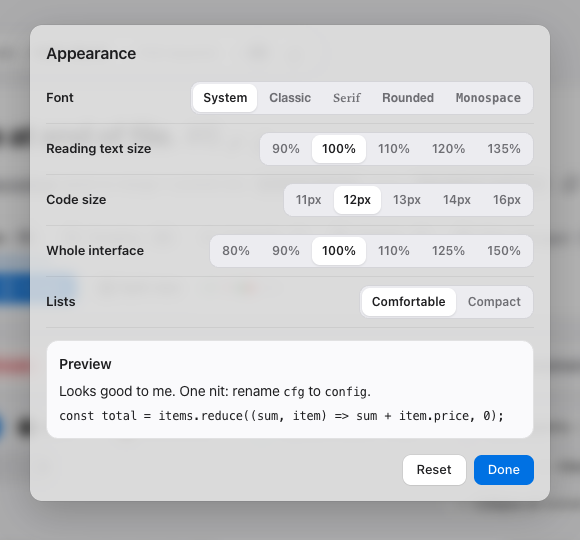

#### Zoom
`Ctrl/⌘` + mouse wheel or `Ctrl/⌘` + `+` / `-` / `0` zooms the whole interface; the level is remembered.

#### Narrow windows
The toolbar keeps the address bar, new tab, notifications, theme switch and account button and folds the rest away; dialogs fit the window width. Drag the window from any empty spot of the toolbar, and double-click it to zoom.

#### Tooltips and shortcuts
Every button has a tooltip that says what it does. Press `?` for the keyboard shortcuts. Clicking outside a dialog closes it.

## Install

Download the installer for your platform from the [Releases page](https://github.com/mejat9806/pullscope/releases): `.dmg` (macOS, Apple silicon), `.exe` / `.msi` (Windows), `.deb` / `.rpm` / `.AppImage` (Linux).

The installers are not code-signed, so macOS (Gatekeeper) and Windows (SmartScreen) warn on first launch. Right-click and choose Open on macOS, or "More info" then "Run anyway" on Windows.

## Sign in

Pullscope requires a GitHub sign-in; without one it shows a sign-in screen instead of loading slowly at 60 requests an hour.

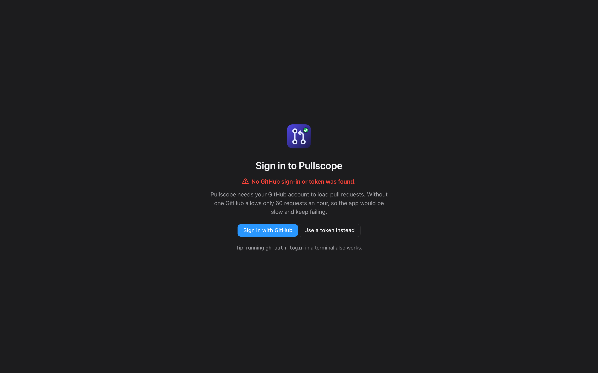

Choose **Sign in with GitHub** (device flow: enter the code shown on github.com), or **Use a token instead** and paste a **classic** personal access token with the `repo` scope (add `notifications` for the notifications poll).

The token is stored in the macOS Keychain, Windows Credential Manager or the Linux Secret Service (a running keyring such as GNOME Keyring is needed). `GITHUB_TOKEN` and `gh auth login` also work.

## Build from source

You need Rust. On macOS, with Homebrew's rustup:

```bash
export PATH=/opt/homebrew/opt/rustup/bin:$PATH
cd src-tauri
cargo run --bin github-pr-view                            # opens Home
cargo run --bin github-pr-view -- octocat/Hello-World#6   # opens a PR directly
```

Build and install a macOS app bundle into `/Applications`:

```bash
bash scripts/bundle.sh
```

The frontend is TypeScript + Preact under `web/`, bundled by esbuild into `ui/app.js`, which is generated and not committed (`bundle.sh` and the release workflow build it). Build it once after cloning and after editing, with `cd web && npm ci && npm run check && npm run build` (`npm run watch` while developing); `check` runs `tsc --noEmit` under `strict` and rejects explicit `any`.

**Code style** (ported from the Citadel monorepo and adapted): Prettier (`web/.prettierrc`: 80 columns, single quotes, trailing commas, `arrowParens: avoid`) and ESLint 9 flat config (`web/eslint.config.mjs`, rules in `web/eslint/base-rules.mjs`, the ones this codebase does not follow, with reasons, in `web/eslint/overrides.mjs`). Run `npm run format` and `npm run lint` (`lint:fix` for auto-fixes) in `web/`; CI runs `check`, `lint` and `format:check`. Names must say what they hold: single-letter names are rejected (`id-length`), and so are `cb` and `callback`, so write `event`, `bundle` or `appState`, not `e`, `b` or `S`. Disable a rule only with a comment saying why.

The rich editor and syntax highlighter are bundled with esbuild from `editor/`; the output is already committed in `ui/vendor/`. To rebuild them: `cd editor && npm install && npm run build`.

### Preview the UI in a browser

`cargo run --bin dump -- owner/repo#N ui/fixture.json` records the exact data the app renders. The UI can then run in any browser with no GitHub access:

```bash
python3 -m http.server 8765 --directory ui
# http://localhost:8765/index.html?fixture=fixture-hello-world-6.json&mode=dark&tab=files
```

Writing actions need the desktop app; in the browser preview they are disabled.

### Releases

Installed builds update themselves (see [In-app updates](#in-app-updates)); updates are signed with `TAURI_SIGNING_PRIVATE_KEY`, set as a repository secret. Unit tests run in CI (`cargo test --lib`).

Add the changes to the `## [Unreleased]` section of `CHANGELOG.md` as you go. To release, rename that section to the new version, bump the version in `src-tauri/tauri.conf.json`, `src-tauri/Cargo.toml` and `Cargo.lock`, and tag.

Pushing a `v*` tag runs `.github/workflows/release.yml`, which builds installers for macOS, Windows and Linux and attaches them to a **draft** GitHub Release whose notes are the matching `CHANGELOG.md` section. Publish the draft from the Releases page.

## Project layout

| Path | What is in it |
|---|---|
| `src-tauri/src/github.rs` | Fetches a PR, its timeline, files, review comments, checks and thread state from the REST and GraphQL APIs |
| `src-tauri/src/lib.rs` | Tauri commands: write actions, branches, create PR, notifications, inbox, markdown preview |
| `web/` | Frontend source (TypeScript, Preact, esbuild): `src/app/*` modules, `src/components/*` Preact components, `src/types.ts` domain types |
| `ui/app.js`, `ui/app.css` | Built frontend bundle (generated from `web/`, gitignored) and styles |
| `editor/` | Source of the rich text editor and highlighter bundles |
| `CHANGELOG.md` | Release notes per version; the tag's section becomes the GitHub release body |
| `scripts/` | `bundle.sh` builds and installs the macOS app |
| `swift/` | A separate native SwiftUI app (see below) |
| `docs/screenshots/` | Images used in this README |

## Known limits

- Re-running checks only works for GitHub Actions; checks from other services open on GitHub instead.
- Auto-merge only works if the repository has "Allow auto-merge" turned on.
- Windows and Linux notifications are plain banners; clicking one does not open the PR yet.
- GitHub allows 5,000 authenticated requests an hour. A 403 "rate limit exceeded" resets within the hour; choosing fewer repositories and the built-in ETag cache keep usage low.
- GitHub has no push channel for third-party apps, so notifications are polled about once a minute while the app is open.
- The pieces that talk to GitHub (resolve, apply suggestion, create PR, notifications, re-run) have been exercised by hand on a few repositories; automated tests cover parsing and the HTTP layer only.

## Native Swift apps (Mac + iPhone/iPad)

`swift/` holds a SwiftUI codebase that builds a macOS app and an iOS app with no web view. It needs Xcode and [XcodeGen](https://github.com/yonaskolb/XcodeGen).

```bash
cd swift && xcodegen generate
# Mac:    xcodebuild -project Reviewer.xcodeproj -scheme Reviewer-macOS -configuration Release build
# iPhone: xcodebuild -project Reviewer.xcodeproj -scheme Reviewer-iOS -destination 'platform=iOS Simulator,name=iPhone 18 Pro' build
```

On the Mac the token comes from `gh auth token`, then the Keychain; on iOS paste a token with the key button. It covers the repo and PR browser (filter, sort, group), conversation with attention chips, account filter and resolved-thread folding, timeline, commits, checks, files, and write actions (comment, reply, review, merge, close/reopen). Composer shortcuts: `/` block menu, `@` people, `:` emoji. It polls for notifications every minute and can pin a PR as a Live Activity in the Dynamic Island.

Not ported yet: the rich editor, split view and reactions. The Swift app does not have the newer features above (create PR, inbox, line comments, merge box).
